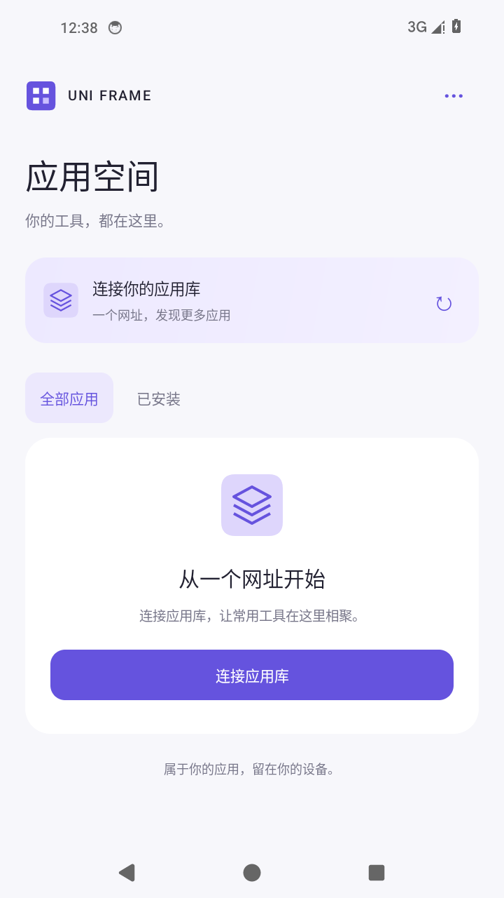
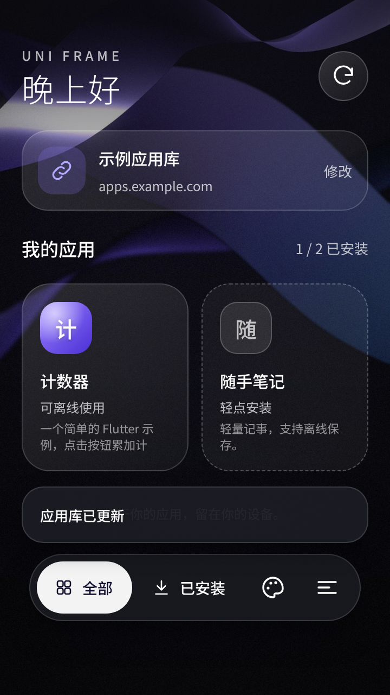
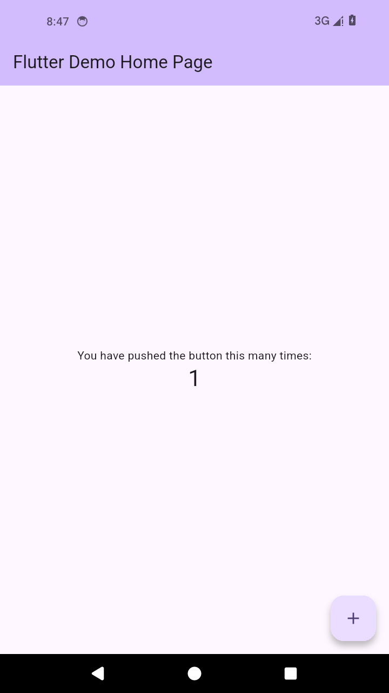
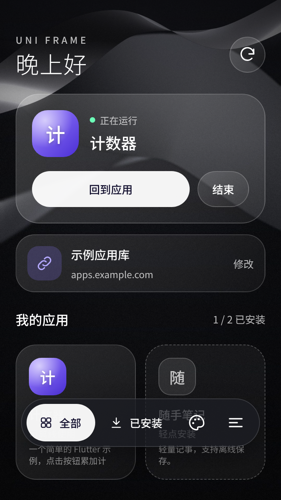
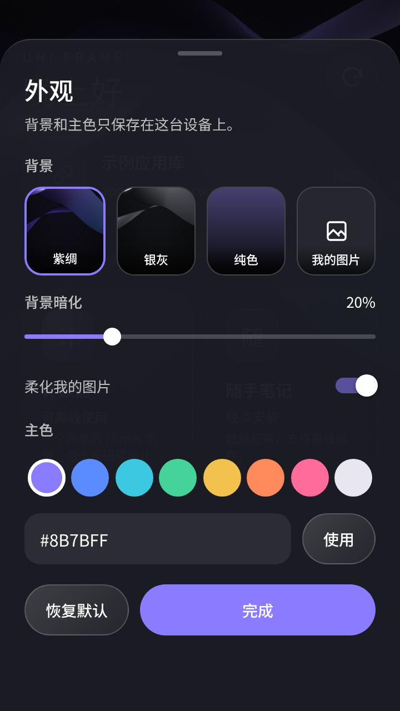

<div align="center">

# Uni Frame

**Update and try your Flutter apps on Android, with less time spent moving and installing APKs.**

English · [简体中文](README.zh-CN.md)

[Getting started](docs/getting-started.md) · [Signing & migration](docs/signing.md) · [App integration](docs/app-repositories.md) · [Agent skill](.agents/skills/uni-frame-app-development/SKILL.md)

</div>

## Why I built this

I started Uni Frame because getting each new build onto my phone had become a chore.

I work on several Flutter projects, sometimes with GPT helping me write code and compile it in the cloud. But a finished build still leaves me with work to do: download the APK, transfer it to my phone, install or upgrade the app, and only then check whether the change works. If it needs another adjustment, I do it all again. Even a small change means repeating those steps, and each project adds another app to keep up to date.

What I wanted was straightforward: build and publish a new version in the cloud, then pick up my phone and keep testing. I built Uni Frame to keep these projects in one Android app, where my phone can get the published versions directly, so I don't have to move each build from my computer to my phone myself.

## A look inside

<table>
  <tr>
    <td align="center"><br><b>Connect a library</b></td>
    <td align="center"><br><b>Choose an app</b></td>
    <td align="center"><br><b>Open it in Uni Frame</b></td>
  </tr>
  <tr>
    <td align="center"><br><b>Return to a running app</b></td>
    <td align="center"><br><b>Make it yours</b></td>
    <td></td>
  </tr>
</table>

Renders of the redesigned client at 720 × 1280 (the counter is an Android 14 emulator capture). The client UI is currently in Chinese. [Image details](docs/screenshots/README.md).

## From a cloud build to your phone

Once a project is integrated with Uni Frame, the usual testing workflow is:

1. Build a new version in the cloud and publish its module to an app library hosted over HTTPS or publicly on Google Drive.
2. Open Uni Frame on your phone, refresh the library, and download or update the app.
3. Open the app inside Uni Frame and keep testing. Installed apps can also be reopened offline.

Each integrated Flutter project can produce both a standalone APK and a `.uaf` module from the same codebase. It keeps its own repository and can still be installed independently. When testing the module inside Uni Frame, you no longer need to transfer and separately install an APK for each app update.

Uni Frame uses [Flutter](https://flutter.dev) and [Tencent Shadow](https://github.com/Tencent/Shadow). It runs modules built for its runtime and cannot import arbitrary APKs. Before loading a module, it checks publisher signatures, file hashes and runtime compatibility. Updates to the Uni Frame client itself still go through Android's installation confirmation.

## Use an app library

1. Install the Uni Frame client supplied by your library's publisher.
2. Choose **连接应用库** and paste the library URL. For Drive, use the catalog file's share link.
3. Install an app from the list, then open it. Refresh the library to check for app updates.

Use **更多选项 → 检查更新** to check for a newer client. The client and its modules must use the same publisher trust and compatible runtime profiles.

## Build an app

Start with the [build setup](docs/getting-started.md), then create a project:

```bash
python3 tools/new-app.py /work/my_app \
  --name my_app --package dev.example.my_app --title 'My App'
```

The generated project contains a Flutter counter, Android build flavors and a framework dependency pinned at `vendor/uni-frame`. Replace the counter with your app, commit its source and lockfile, then build a release:

```bash
cd /work/my_app
python3 tools/uni-frame.py release --sequence 1 \
  --output /work/releases/my-app-1 --key /secure/uni-frame/publisher.pem
```

The release command runs analysis and tests, builds both flavors for each configured ABI, and packages signed modules. [Stage and publish the release](docs/getting-started.md#publish-a-library) to make it available in the client.

Existing projects can use the [Android integration guide](docs/app-repositories.md). Coding agents can follow the included [development skill](.agents/skills/uni-frame-app-development/SKILL.md); publishing uses ordinary HTTPS hosting or the Google Drive API.

## Current support

| Area | Preview support |
| --- | --- |
| Android | Declared minimum: Android 7.0 / API 24; emulator validation on Android 14 |
| Architectures | ARM64 and x86_64 |
| Runtime | Flutter 3.41.6 / Dart 3.11.4, pinned Shadow build |
| App sessions | One running module at a time |
| Distribution | HTTPS and public Google Drive catalog files |
| Project Android services | Not supported yet |

Modules run as trusted publisher code; the host is not a security sandbox for arbitrary apps. Catalogs and bundles expire and need renewal. Device permissions, BLE and other hardware integrations need testing on the target devices. Drive downloads are subject to Google's availability and download limits.

## In this repository

| Path | Contents |
| --- | --- |
| [`android/host`](android/host) | App library UI, module loading and client updates |
| [`integrations/android`](integrations/android) | Shared Android adapters and toolchain settings |
| [`templates/flutter-android`](templates/flutter-android) | App template with standalone and module flavors |
| [`tools`](tools) | Project generation, builds, signing and publishing |
| [`uni_frame`](uni_frame) · [`tests`](tests) | Package format, verification and tests |
| [`docs`](docs) | Setup, app integration and screenshots |
