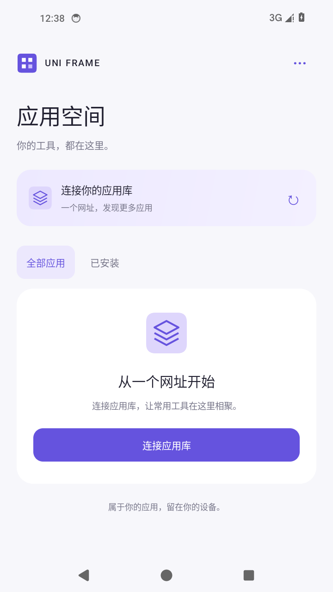
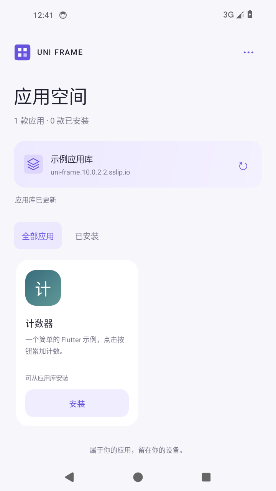
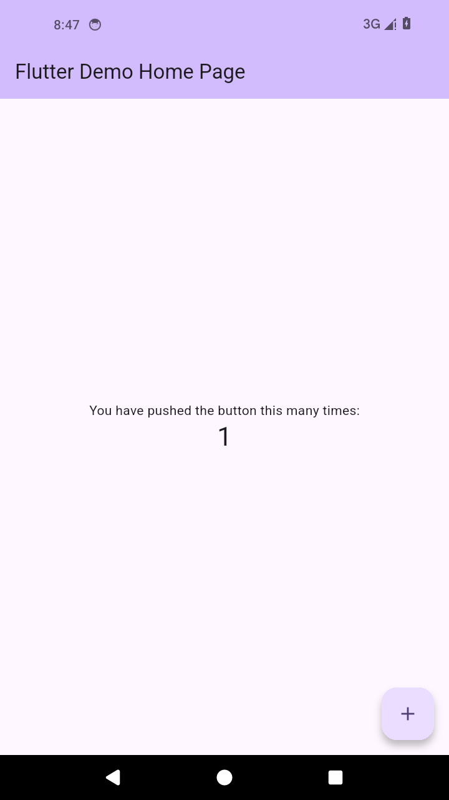

<div align="center">

# Uni Frame

**在手机上更新和试用自己的 Flutter 应用，少折腾安装包。**

[English](README.md) · 简体中文

[开发入门](docs/getting-started.md) · [接入已有项目](docs/app-repositories.md) · [Agent 开发技能](.agents/skills/uni-frame-app-development/SKILL.md)

</div>

## 为什么做这个

做 Uni Frame 的起因很简单：我觉得反复把 App 装到手机上调试，太麻烦了。

我平时会同时开发几个 Flutter 项目，也会让 GPT 在云端帮我改代码、编译。可云端编译完成以后，我还得把安装包下载下来，传到手机，再安装或升级，才能看看这次改动有没有用。试完发现还要调整，就再来一遍。哪怕只改了一个小地方，这些步骤也得重复；项目一多，每个 App 都要折腾一次。

我想要的流程很直接：云端构建并发布好新版本，手机上就能找到更新，打开继续试。为此，我做了 Uni Frame，把这些项目放在同一个手机 App 里管理，让手机直接获取已发布的版本，省掉我在电脑和手机之间来回搬安装包的步骤。

## 界面预览

<table>
  <tr>
    <td align="center"><br><b>连接应用库</b></td>
    <td align="center"><br><b>选择应用</b></td>
    <td align="center"><br><b>在 Uni Frame 中运行</b></td>
  </tr>
</table>

Android 14 模拟器实拍：0.4.0 客户端与通用 Flutter 计数器模板。客户端目前使用中文界面。[截图说明](docs/screenshots/README.md)。

## 从云端构建到手机试用

接入 Uni Frame 后，日常试用的流程是：

1. 在云端构建新版本，把应用模块发布到 HTTPS 站点或公开的 Google Drive 应用库。
2. 在手机上打开 Uni Frame，刷新应用库，下载或更新对应应用。
3. 在 Uni Frame 里打开应用，继续测试。已安装的应用也可以离线打开。

每个接入的 Flutter 项目可以用同一套代码构建独立 APK 和 `.uaf` 模块。项目仍保留自己的仓库，也能独立安装使用；在 Uni Frame 里试用模块时，就不用每次都手动传输 APK，再单独安装。

Uni Frame 基于 [Flutter](https://flutter.dev) 和 [Tencent Shadow](https://github.com/Tencent/Shadow)，运行的是按框架要求构建的应用模块，不支持直接导入任意 APK。加载前会检查发布者签名、文件哈希和运行时兼容性。Uni Frame 客户端本身需要升级时，仍要通过 Android 的安装确认。

## 使用应用库

1. 安装应用库发布者提供的 Uni Frame 客户端。
2. 选择「**连接应用库**」，粘贴网址。使用 Drive 时，粘贴目录文件的分享链接。
3. 在列表中安装并打开应用；之后点击刷新，即可查看应用更新。

客户端自身的更新入口是「**更多选项 → 检查更新**」。客户端与应用模块需要使用一致的发布者信任配置，以及兼容的运行时。

## 开发一个应用

先按[开发入门](docs/getting-started.md)配置构建环境，再创建项目：

```bash
python3 tools/new-app.py /work/my_app \
  --name my_app --package dev.example.my_app --title 'My App'
```

生成的项目包含 Flutter 计数器、Android 构建配置，以及固定版本的 `vendor/uni-frame` 框架依赖。将计数器替换成自己的应用，提交源码和依赖锁文件后构建：

```bash
cd /work/my_app
python3 tools/uni-frame.py release --sequence 1 \
  --output /work/releases/my-app-1 --key /secure/uni-frame/publisher.pem
```

发布命令会运行分析和测试，为配置的每种架构构建独立 APK 与模块，再生成签名包。完成[应用库发布](docs/getting-started.md#publish-a-library)后，客户端就能获取更新。

已有项目可以参考 [Android 接入说明](docs/app-repositories.md)。使用编码 Agent 时，可以加载仓库内的[开发技能](.agents/skills/uni-frame-app-development/SKILL.md)；分发使用普通 HTTPS 托管或 Google Drive API。

## 当前支持范围

| 项目 | 预览版支持情况 |
| --- | --- |
| Android | 声明最低支持 Android 7.0 / API 24；已在 Android 14 模拟器验证 |
| 架构 | ARM64、x86_64 |
| 运行时 | Flutter 3.41.6 / Dart 3.11.4、固定版本的 Shadow |
| 应用运行 | 同时运行一个模块 |
| 分发方式 | HTTPS、Google Drive 公开目录文件 |
| 应用自带的 Android Service | 暂不支持 |

模块来自受信任的发布者，宿主不是任意应用的安全沙箱。目录和模块有有效期，需要续期发布。权限、蓝牙及其他硬件功能仍需在目标设备上验证。Drive 下载受 Google 的服务可用性和下载额度限制。

## 仓库结构

| 路径 | 内容 |
| --- | --- |
| [`android/host`](android/host) | 应用库界面、模块加载、客户端更新 |
| [`integrations/android`](integrations/android) | 共用 Android 适配代码与工具链配置 |
| [`templates/flutter-android`](templates/flutter-android) | 支持独立 APK 和模块的应用模板 |
| [`tools`](tools) | 项目生成、构建、签名和发布工具 |
| [`uni_frame`](uni_frame) · [`tests`](tests) | 包格式、校验逻辑与测试 |
| [`docs`](docs) | 环境配置、项目接入和截图 |
